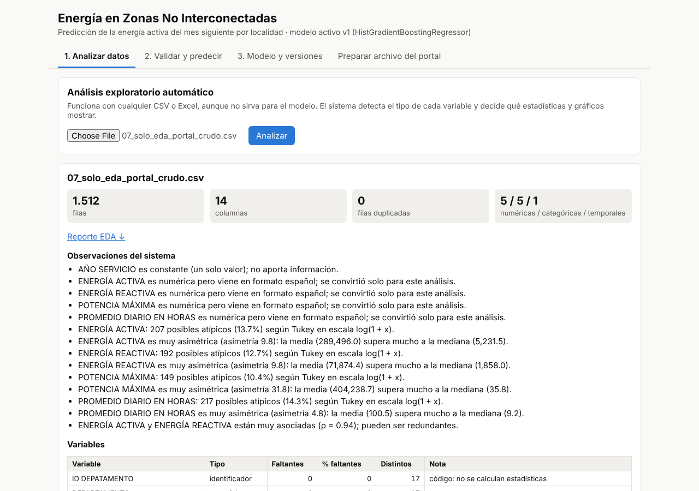
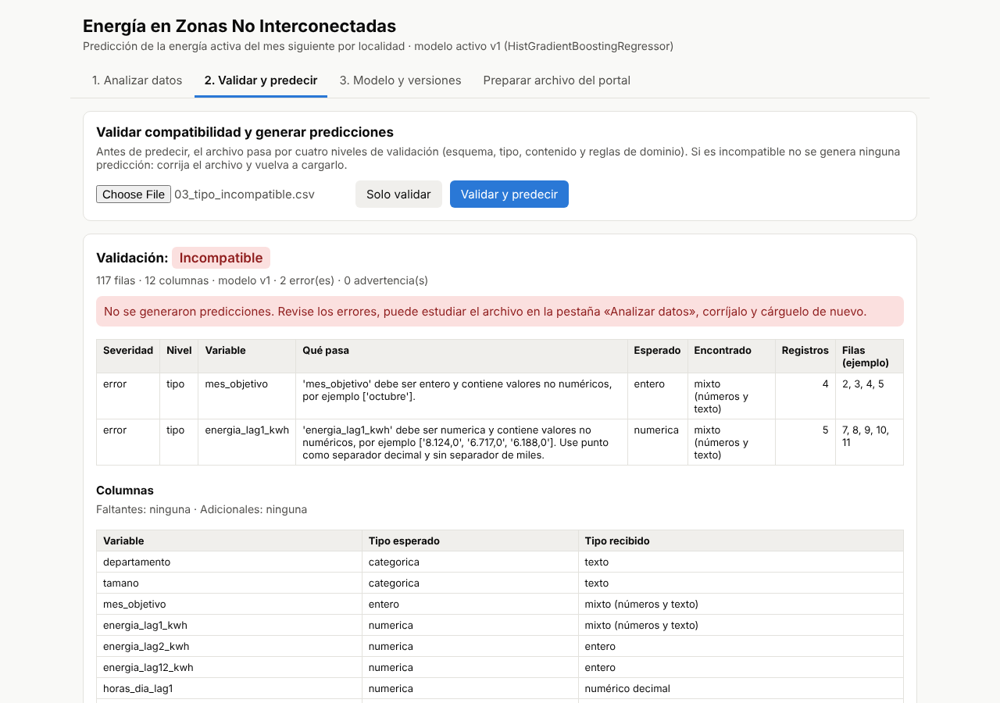
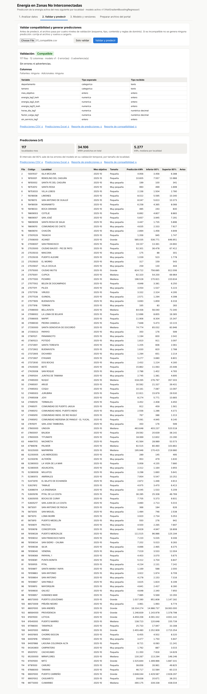
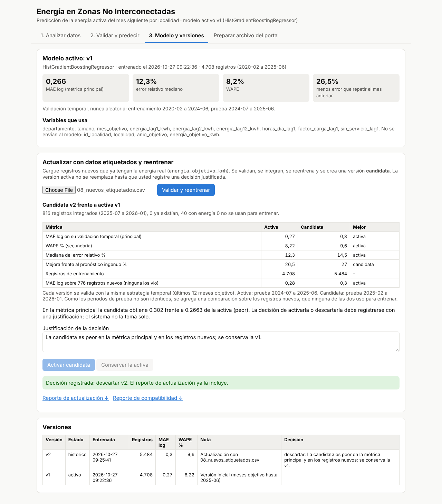
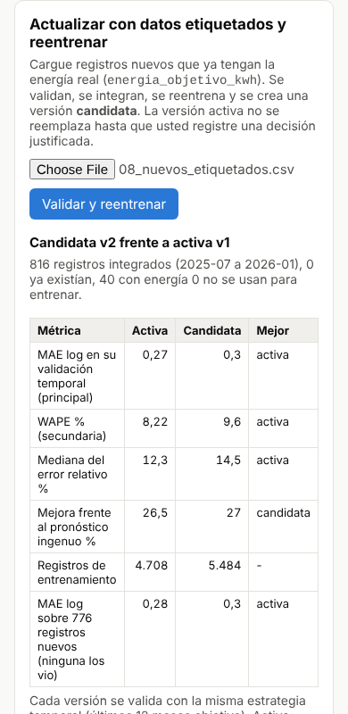

# ⚡ Sistema Web ZNI — Análisis y Predicción de Energía

Aplicación web desarrollada para analizar datos de prestación del servicio de energía en las **Zonas No Interconectadas (ZNI) de Colombia**, automatizar el análisis exploratorio de datos y generar predicciones de consumo energético mediante Machine Learning.

El sistema permite cargar nuevos datos, validar su compatibilidad con el modelo, realizar análisis exploratorio, generar predicciones, consultar versiones del modelo, reentrenarlo y descargar reportes.

> **Proyecto desarrollado por Alex David García Chala**  
> Fundación Universitaria Uniclaretiana · Ingeniería de Sistemas

---

## 🎯 ¿Qué problema resuelve?

En las Zonas No Interconectadas de Colombia, la prestación del servicio de energía presenta desafíos relacionados con la planificación de la demanda, el combustible y la logística.

Este proyecto busca apoyar ese proceso mediante un sistema capaz de **estimar la energía activa que entregará cada localidad durante el mes siguiente**, utilizando información histórica.

El objetivo es convertir datos históricos en información útil para:

- 📊 Analizar el comportamiento del consumo energético.
- 🔮 Anticipar la demanda del siguiente mes.
- ⛽ Apoyar la planificación del combustible.
- 🚚 Mejorar la planificación logística.
- 🧪 Validar automáticamente nuevos conjuntos de datos.
- 🤖 Reentrenar y controlar diferentes versiones del modelo.

---

## 🧠 Machine Learning

El modelo principal utilizado es:

**HistGradientBoostingRegressor**

El entrenamiento se realiza sobre:

```text
log(1 + kWh)
```

y utiliza una **validación temporal**, respetando el orden cronológico de los datos.

### Evaluación

| Métrica | Resultado |
|---|---:|
| MAE en escala log | **0,266** |
| Mejora frente al baseline | **26,5 % menos error** |
| Validación | Temporal |
| Modelo | HistGradientBoostingRegressor |

### División temporal

```text
Entrenamiento
Hasta 2024-06

        ↓

Prueba
2024-07 → 2025-06
```

El modelo también genera **intervalos de predicción del 80 %**, permitiendo representar la incertidumbre asociada a las predicciones.

Más información sobre la metodología:

`docs/documento_tecnico.md`

---

# 🚀 Funcionalidades

## 📊 Análisis exploratorio automático

El sistema permite cargar archivos CSV o Excel y generar automáticamente:

- Tipos de variables.
- Valores faltantes.
- Valores atípicos.
- Distribuciones.
- Frecuencias.
- Correlaciones.
- Gráficos.
- Reporte EDA descargable.

---

## 🔎 Validación de datos

Antes de realizar una predicción, el sistema verifica la información recibida mediante diferentes niveles de validación.

Se comprueba:

- Existencia de variables requeridas.
- Tipos de datos.
- Valores faltantes.
- Categorías.
- Rangos permitidos.
- Reglas de dominio.
- Columnas adicionales.

Esto evita generar predicciones cuando los datos no cumplen las condiciones necesarias.

---

## 🔮 Predicción

Para archivos compatibles, el sistema genera:

- Predicción de energía activa.
- Intervalo de predicción del 80 %.
- Tabla de resultados.
- Gráfico de predicciones.
- Exportación a CSV.
- Exportación a Excel.
- Reporte HTML.

---

## ♻️ Reentrenamiento y versiones del modelo

El sistema permite incorporar nuevos datos etiquetados y generar una **versión candidata** del modelo.

La nueva versión se compara con el modelo actualmente activo antes de decidir si debe reemplazarlo.

El registro de versiones permite manejar estados como:

```text
Activo
Candidato
Histórico
```

Esto permite mantener trazabilidad sobre los modelos utilizados.

---

# 🌐 Aplicación web

La API y la interfaz web funcionan dentro del mismo proyecto.

### Secciones principales

| Sección | Funcionalidad |
|---|---|
| 🏠 Inicio | Información general e indicadores del modelo |
| 📊 Analizar datos | EDA automático de CSV y Excel |
| 🔮 Validar y predecir | Validación y generación de predicciones |
| 🧹 Preparar datos | Transformación del CSV original del portal |
| 🤖 Modelo y versiones | Métricas, algoritmos y control de versiones |
| 📄 Reportes | Historial y archivos descargables |
| 🧪 Archivos de prueba | Ejecución de escenarios de validación |
| ℹ️ Acerca del proyecto | Metodología, equipo y arquitectura |

---

# 🏗️ Arquitectura

La aplicación está organizada en diferentes componentes para separar las responsabilidades del sistema.

```text
                    ┌──────────────────────┐
                    │     Usuario Web      │
                    └──────────┬───────────┘
                               │
                               ▼
                    ┌──────────────────────┐
                    │      FastAPI         │
                    │       main.py        │
                    └──────────┬───────────┘
                               │
             ┌─────────────────┼─────────────────┐
             │                 │                 │
             ▼                 ▼                 ▼
       ┌───────────┐     ┌────────────┐    ┌────────────┐
       │ Validación│     │    EDA     │    │   Modelo   │
       └───────────┘     └────────────┘    └────────────┘
             │                 │                 │
             └─────────────────┼─────────────────┘
                               ▼
                    ┌──────────────────────┐
                    │     Reportes         │
                    │ CSV · Excel · HTML   │
                    └──────────────────────┘
```

Diagrama completo:

[Ver arquitectura](docs/arquitectura.png)

---

# 🛠️ Tecnologías

### Lenguaje

- Python 3.10+

### Análisis y Machine Learning

- Pandas
- NumPy
- Scikit-learn
- Matplotlib

### Backend

- FastAPI
- Uvicorn

### Machine Learning

- HistGradientBoostingRegressor
- Joblib

### Testing

- Pytest

### Frontend

- HTML
- CSS
- JavaScript

### Documentación y reportes

- Markdown
- HTML
- CSV
- Excel

---

# 📁 Estructura del proyecto

```text
zni-app/
│
├── app/
│   ├── main.py
│   ├── config.py
│   ├── eda.py
│   ├── limpieza.py
│   ├── modelo.py
│   ├── reportes.py
│   ├── validacion.py
│   │
│   └── static/
│       ├── index.html
│       ├── css/
│       ├── js/
│       └── img/
│
├── config/
│   └── esquema.json
│
├── datos/
│   └── variables_modelo.csv
│
├── modelos/
│   ├── registro.json
│   └── v1/
│       └── metadatos.json
│
├── pruebas/
│   └── escenarios/
│
├── tests/
│   └── test_escenarios.py
│
├── scripts/
│   ├── entrenar_inicial.py
│   └── generar_escenarios.py
│
├── docs/
│   ├── arquitectura.png
│   ├── arquitectura.svg
│   ├── arquitectura.mmd
│   ├── documento_tecnico.md
│   └── evidencia/
│
├── requirements.txt
├── README.md
└── .gitignore
```

> Los datasets originales, modelos binarios y archivos generados se mantienen fuera del repositorio mediante `.gitignore`.

---

# ⚙️ Instalación

## 1. Clonar el repositorio

```bash
git clone https://github.com/ALEXDAVID09/prediccion-energia-zni.git
cd prediccion-energia-zni
```

## 2. Crear entorno virtual

### Windows

```powershell
python -m venv .venv
```

Activar:

```powershell
.venv\Scripts\activate
```

### Linux / macOS

```bash
python3 -m venv .venv
source .venv/bin/activate
```

## 3. Instalar dependencias

```bash
pip install -r requirements.txt
```

---

# ▶️ Ejecutar la aplicación

Iniciar FastAPI:

```bash
uvicorn app.main:app --reload
```

La aplicación estará disponible en:

```text
http://localhost:8000/
```

Documentación interactiva de la API:

```text
http://localhost:8000/docs
```

---

# 🧪 Pruebas automáticas

El proyecto incluye pruebas automatizadas mediante **Pytest**.

Ejecutar:

```bash
pytest -q
```

Los escenarios verifican diferentes situaciones de compatibilidad de los datos.

| Escenario | Resultado |
|---|---|
| Archivo compatible | Predicción generada |
| Variable faltante | Incompatible |
| Tipo de dato incorrecto | Incompatible |
| Valores faltantes | Incompatible |
| Nueva categoría | Compatible con advertencia |
| Valor fuera de escala | Incompatible |
| Columnas adicionales | Compatible con advertencia |
| Dataset del portal | EDA disponible |
| Reglas de dominio | Incompatible |
| Nuevos datos etiquetados | Nueva versión candidata |

---

# 🔌 API

| Operación | Método | Endpoint |
|---|---|---|
| Analizar dataset | POST | `/api/eda` |
| Validar compatibilidad | POST | `/api/validar` |
| Generar predicciones | POST | `/api/predecir` |
| Consultar modelo activo | GET | `/api/modelo` |
| Listar versiones | GET | `/api/modelo/versiones` |
| Actualizar modelo | POST | `/api/modelo/actualizar` |
| Decisión sobre versión | POST | `/api/modelo/versiones/{version}/decision` |
| Descargar reporte | GET | `/api/reportes/{proceso}/{tipo}` |
| Historial de cargas | GET | `/api/procesos` |
| Listar escenarios | GET | `/api/escenarios` |
| Obtener escenario | GET | `/api/escenarios/{archivo}` |
| Preparar datos | POST | `/api/preparar` |

---

# 🧪 Demostración

El proyecto incluye diferentes archivos de prueba para demostrar el comportamiento del sistema.

### 1. EDA

Utilizar:

```text
pruebas/escenarios/07_solo_eda_portal_crudo.csv
```

El sistema analiza automáticamente las variables y genera el reporte exploratorio.

### 2. Archivo incompatible

Utilizar:

```text
pruebas/escenarios/03_tipo_incompatible.csv
```

El sistema identifica los errores y evita generar una predicción.

### 3. Archivo compatible

Utilizar:

```text
pruebas/escenarios/01_compatible.csv
```

Se generan las predicciones junto con su intervalo de confianza.

### 4. Actualización del modelo

Utilizar:

```text
pruebas/escenarios/08_nuevos_etiquetados.csv
```

El sistema genera una nueva versión candidata y la compara con el modelo activo.

---

# 📸 Evidencias

### Análisis exploratorio



### Validación de datos



### Predicciones



### Actualización del modelo



### Interfaz adaptable



---

# 📊 Resultados

El modelo principal obtuvo:

```text
MAE log = 0.266
```

representando aproximadamente:

```text
26.5 % menos error
```

respecto al baseline utilizado como referencia.

La evaluación se realizó mediante una estrategia temporal para evitar utilizar información futura durante el entrenamiento.

---

# 🔬 Metodología

El flujo general del sistema es:

```text
Datos originales
       ↓
Limpieza y preparación
       ↓
Variables temporales
       ↓
Validación
       ↓
Análisis exploratorio
       ↓
Entrenamiento
       ↓
Validación temporal
       ↓
Predicción
       ↓
Intervalo del 80 %
       ↓
Reportes
```

---

# 👨‍💻 Autor

## Alex David García Chala

**Estudiante de Ingeniería de Sistemas**

Intereses profesionales:

- 📊 Data Analytics
- 📈 Business Intelligence
- 🤖 Machine Learning
- 🐍 Python
- 🗄️ SQL
- 📊 Visualización de datos
- 🚀 Desarrollo de soluciones basadas en datos

---

# 📚 Documentación

Para conocer con mayor detalle la metodología, arquitectura y decisiones técnicas del proyecto:

- `docs/documento_tecnico.md`
- `docs/arquitectura.png`
- `docs/arquitectura.mmd`

---

## ⭐ Proyecto de portafolio

Este proyecto representa la aplicación de conocimientos de **análisis de datos, Machine Learning, desarrollo backend, automatización, validación de datos, pruebas y documentación técnica** en una solución orientada a un problema real.

**Desarrollado por Alex David García Chala · Ingeniería de Sistemas**