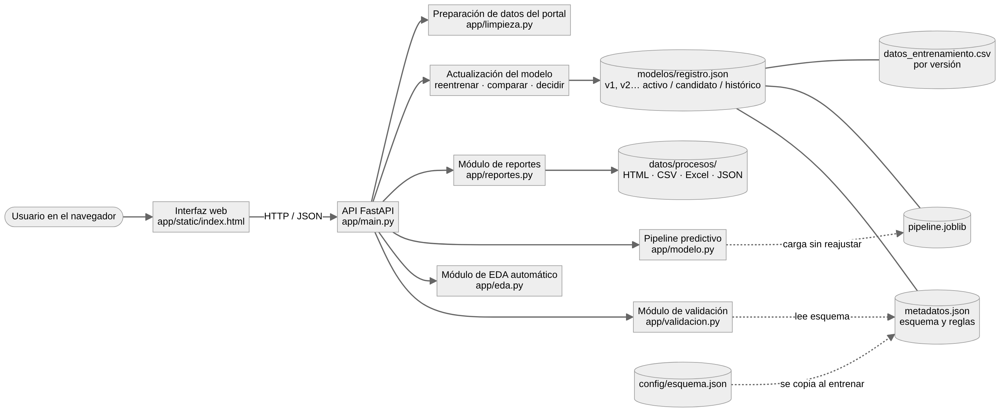

# Sistema web ZNI: análisis automático y predicción de energía

Aplicativo web que convierte el análisis de la **prestación del servicio de energía en las Zonas No Interconectadas (ZNI) de Colombia** en un sistema que recibe datos nuevos, verifica si el modelo puede procesarlos, genera el análisis exploratorio, produce predicciones, exporta reportes y permite reentrenar el modelo con control de versiones.

**Qué predice:** la energía activa (kWh) que entregará cada localidad **el mes siguiente**, a partir de lo que pasó en los meses anteriores. Sirve para anticipar la demanda y planear el combustible y la logística, que en zonas remotas son muy costosos.

Proyecto de la Fundación Universitaria Uniclaretiana · Integrantes: Alex David Moya Bejarano y Alex David Garcia Chala · Docente: Carlos Stiwar Asprilla Mosquera.

## Requisitos e instalación

Python 3.10 o superior.

```bash
python -m venv .venv
source .venv/bin/activate        # en Windows: .venv\Scripts\activate
pip install -r requirements.txt
```

El repositorio ya trae el modelo activo (`modelos/v1`). Para volver a generarlo desde el CSV del portal:

```bash
python -m scripts.entrenar_inicial      # entrena la v1 y la deja como activa
python -m scripts.generar_escenarios    # regenera los archivos de prueba
```

## Iniciar la API y la interfaz

```bash
uvicorn app.main:app --reload
```

- Sitio web: <http://localhost:8000/>
- Documentación interactiva de la API (para probar cada operación): <http://localhost:8000/docs>

El sitio lo sirve la misma API, así que no hay un segundo proceso que iniciar. Todo se usa desde ahí:

| Sección del sitio | Qué hace |
|---|---|
| Inicio | Qué es el sistema, indicadores del modelo activo y los pasos de uso |
| Analizar datos | EDA automático de cualquier CSV o Excel |
| Validar y predecir | Validación en 4 niveles y predicciones con intervalo del 80%, gráfico y tabla |
| Preparar datos del portal | Convierte el CSV del portal en la tabla del modelo; puede predecir en el mismo paso |
| Modelo y versiones | Métricas, comparación de algoritmos, variables, reentrenamiento y decisión sobre candidatas |
| Reportes | Historial de todas las cargas con sus reportes descargables |
| Archivos de prueba | Los escenarios obligatorios: «Probar» los ejecuta directamente, «Descargar» los guarda |
| Acerca del proyecto | Equipo, datos, metodología y diagrama de arquitectura |

## Prueba completa (demostración)

La forma más rápida es la sección **Archivos de prueba**: cada botón «Probar» carga el archivo y lo ejecuta en la sección correcta. Paso a paso:

1. **Analizar datos:** cargue `pruebas/escenarios/07_solo_eda_portal_crudo.csv`. El sistema detecta los tipos (incluye números en formato español y fechas), muestra faltantes, atípicos, frecuencias, correlaciones y gráficos, y deja descargar el reporte EDA.
2. **Validar y predecir con un archivo incompatible:** cargue `03_tipo_incompatible.csv`. El estado sale *Incompatible*, se explica qué variable falla, qué se esperaba, qué se encontró y en qué filas. No se genera ninguna predicción.
3. **Validar y predecir con un archivo compatible:** cargue `01_compatible.csv`. Se generan las predicciones con su intervalo del 80% y se descargan en CSV, Excel y HTML.
4. **Modelo y versiones:** cargue `08_nuevos_etiquetados.csv`. Se valida, se integra, se reentrena y aparece una versión **candidata** comparada con la activa. Escriba una justificación y elija activarla o conservar la activa.
5. **Preparar archivo del portal:** cargue el CSV original del portal de datos abiertos y descargue la tabla lista para predecir el mes siguiente.

## Pruebas automáticas

```bash
pytest -q
```

Cubren los 8 escenarios obligatorios. Trabajan sobre una copia temporal de `modelos/`, así que no cambian el modelo real.

| # | Archivo | Resultado esperado |
|---|---|---|
| 1 | `01_compatible.csv` | Compatible, predicciones generadas |
| 2 | `02_falta_variable.csv` | Incompatible: falta `energia_lag1_kwh` |
| 3 | `03_tipo_incompatible.csv` | Incompatible: texto en `mes_objetivo` y números con formato español en `energia_lag1_kwh` |
| 4 | `04_faltantes.csv` | Incompatible: 5 faltantes en `energia_lag1_kwh` |
| 5 | `05a_categoria_nueva_departamento.csv` | Compatible con advertencias: departamento no visto (se predice y se marca) |
| 5 | `05b_categoria_fuera_de_escala.csv` | Incompatible: `tamano` fuera de la escala definida |
| 6 | `06_columnas_adicionales.csv` | Compatible con advertencias: columnas que el modelo no usa |
| 7 | `07_solo_eda_portal_crudo.csv` | Incompatible para predecir, pero el EDA funciona (y sugiere usar «Preparar») |
| 7 | `07b_reglas_de_dominio.csv` | Incompatible: horas > 24, factor de carga > 1, `sin_servicio_lag1` incoherente |
| 8 | `08_nuevos_etiquetados.csv` | Versión candidata creada sin reemplazar la activa |
| extra | `09_pronostico_2026_02.csv` | Pronóstico real de febrero de 2026 (compatible con advertencias: faltan horas por el cambio de formato de la fuente) |

## API

| Operación | Método y ruta |
|---|---|
| Analizar dataset (EDA) | `POST /api/eda` |
| Validar compatibilidad | `POST /api/validar` (`modo` = `prediccion` o `actualizacion`) |
| Generar predicciones | `POST /api/predecir` (responde 422 con el diagnóstico si el archivo es incompatible) |
| Consultar modelo activo | `GET /api/modelo` |
| Listar versiones | `GET /api/modelo/versiones` |
| Actualizar y reentrenar | `POST /api/modelo/actualizar` |
| Registrar decisión sobre una candidata | `POST /api/modelo/versiones/{version}/decision` |
| Descargar reporte | `GET /api/reportes/{proceso}/{tipo}` |
| Historial de cargas | `GET /api/procesos` |
| Archivos de prueba | `GET /api/escenarios` y `GET /api/escenarios/{archivo}` |
| Preparar CSV del portal | `POST /api/preparar` |

## Estructura

```
app/
  main.py          API FastAPI (orquesta todo)
  validacion.py    validación en 4 niveles contra el esquema del modelo
  eda.py           EDA automático según los tipos de variable
  modelo.py        pipeline, validación temporal, predicción y versiones
  limpieza.py      limpieza del CSV del portal (la de la Actividad 3) y variables rezagadas
  reportes.py      reportes HTML
  static/          sitio web (index.html, css/, js/, img/)
config/esquema.json  variables, tipos, faltantes, categorías, rangos y exclusiones
modelos/
  registro.json    versiones: activo, candidato, histórico
  v1/              pipeline.joblib, metadatos.json, datos_entrenamiento.csv
datos/crudos/      CSV original del portal
pruebas/escenarios/  archivos de los escenarios de prueba
tests/             pruebas automáticas
docs/              diagrama de arquitectura, documento técnico y evidencia de reportes
```

## El modelo en una línea

`HistGradientBoostingRegressor` sobre log(1 + kWh), con validación temporal (entrena hasta 2024-06, prueba de 2024-07 a 2025-06). Métrica principal: MAE en escala log = **0,266**, un **26,5% menos error** que repetir el valor del mes anterior. Detalle en `docs/documento_tecnico.md`.


